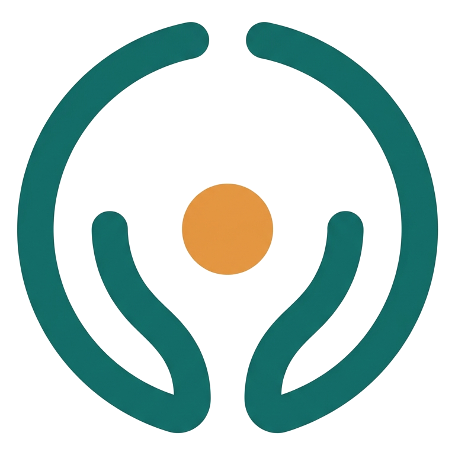

<div align="center">



# INKLUSA

**Inclusive Classroom Intervention Assistant**

*See the barrier. Support the learner.*


</div>

---

## Tentang

INKLUSA adalah *web-based decision support system* yang membantu guru reguler di kelas inklusif mengubah pengamatan terhadap hambatan belajar menjadi intervensi pembelajaran yang terstruktur, melalui siklus:

**Observe → Understand → Act → Reflect**

INKLUSA **tidak mendiagnosis** kondisi medis atau psikologis. Sistem ini berfokus pada hambatan belajar yang dapat diamati di kelas (*Observed Learning Barrier*), dengan prinsip ***learning difficulty ≠ lack of understanding***. Keputusan akhir tetap berada di tangan guru.

### Kaitan dengan SDG 4

| Target | Kontribusi INKLUSA |
| --- | --- |
| **4.5** Akses setara bagi penyandang disabilitas | Membantu PDBK, baik yang terdiagnosis maupun yang mengalami kesulitan belajar spesifik, mendapat akomodasi di kelas reguler |
| **4.a** Lingkungan belajar inklusif dan efektif | Intervensi berfokus pada perbaikan lingkungan dan metode belajar berbasis prinsip UDL |
| **4.c** Peningkatan kualitas guru | Memberi guru reguler opsi strategi yang spesifik, terarah, dan berbasis bukti |

## Fitur Utama

**Sisi Guru**

- **Dashboard.** Ringkasan rencana intervensi per status (*Planned*, *In Progress*, *Needs Reflection*, *Completed*) dan akses cepat ke fitur utama.
- **Quick Check (4 tahap).** Identifikasi hambatan dalam waktu kurang dari 2 menit: pilih konteks dan siswa, pilih kategori hambatan, klarifikasi perilaku, lalu lihat hasil analisis.
- **Possible Supports.** Rekomendasi 2–3 strategi beserta alasannya (*Why it fits*) dan riwayat efektivitasnya.
- **Action Plan.** Rencana intervensi dengan tujuan terukur dan siklus status yang jelas. Rencana yang dibatalkan dapat dipulihkan.
- **Refleksi.** Evaluasi dampak dengan skala 4 tingkat, alasan kendala, dan catatan kualitatif.
- **Pustaka Intervensi.** Pencarian dan filter strategi, lengkap dengan panduan langkah demi langkah dan indikator yang perlu diamati.
- **Profil Siswa.** Pola hambatan, rekam efektivitas strategi, dan *timeline* intervensi secara longitudinal.

**Sisi Administrator**

- Pengelolaan akun guru (termasuk persetujuan pendaftaran), kelas, dan siswa.
- Kurasi basis pengetahuan intervensi.
- Pemantauan agregat efektivitas strategi berdasarkan data refleksi.

**Fondasi Sistem**

- Antarmuka responsif dengan dukungan penuh untuk ponsel (Mobile Tab Bar, Bottom-Sheet, Action Bar).
- Dwibahasa: Bahasa Indonesia dan Inggris.
- Autentikasi dan pembatasan akses berbasis peran (`TEACHER` / `ADMIN`).

### Kategori Hambatan

Rekomendasi pada versi ini mencakup lima kategori hambatan: **Instruksi**, **Membaca**, **Fokus**, **Ekspresi**, dan **Partisipasi**.

## Teknologi

| Lapisan | Teknologi |
| --- | --- |
| Frontend | Next.js 16 (App Router), React 19, Tailwind CSS 4, Framer Motion, Lucide React |
| Backend & API | Elysia.js (di-*mount* pada `/api`), OpenAPI / Swagger UI |
| Autentikasi | Better Auth (email/password, Google OAuth, plugin admin) |
| Basis Data | PostgreSQL, Drizzle ORM, Drizzle Kit |
| Tooling | Bun, TypeScript 5, Biome |

## Struktur Proyek

```
src/
├── app/
│   ├── (auth)/              # Login & registrasi
│   ├── (app)/               # Halaman guru: dashboard, quick-check, interventions,
│   │                        #   action-plans, students, profile
│   ├── admin/               # Portal administrator
│   └── api/[[...slugs]]/    # Entry point Elysia + dokumentasi OpenAPI
├── backend/
│   ├── modules/             # action-plans, admin, knowledge, profile, students
│   │                        #   (masing-masing: index · model · service)
│   └── utils/               # Middleware Better Auth & helper
├── components/              # Komponen UI, landing page, admin
├── db/
│   ├── schema/              # Skema Drizzle
│   └── seed.ts              # Data awal & akun demo
├── lib/                     # Basis pengetahuan, i18n, API client
└── auth.ts                  # Konfigurasi Better Auth
```

## Menjalankan Secara Lokal

### Prasyarat

- [Bun](https://bun.sh)
- PostgreSQL (lokal, atau layanan cloud seperti Supabase/Neon)

### Langkah

```bash
# 1. Clone repository
git clone https://github.com/Xantares-nvrdie/inklusa.git
cd inklusa

# 2. Install dependency
bun install

# 3. Siapkan environment variable
cp .env.example .env

# 4. Buat skema database dan isi data awal
bun run db:push
bun run db:seed

# 5. Jalankan development server
bun run dev
```

Aplikasi berjalan di `http://localhost:3000`.

### Environment Variable

| Variabel | Keterangan |
| --- | --- |
| `DATABASE_URL` | Koneksi PostgreSQL untuk runtime aplikasi (*pooler*) |
| `DIRECT_URL` | Koneksi langsung untuk Drizzle Kit (push / migrate / studio) |
| `BETTER_AUTH_SECRET` | String acak panjang untuk menandatangani sesi (wajib di production) |
| `BETTER_AUTH_URL` | Base URL aplikasi, misalnya `http://localhost:3000` |
| `NEXT_PUBLIC_APP_URL` | Base URL publik aplikasi |
| `GOOGLE_CLIENT_ID` / `GOOGLE_CLIENT_SECRET` | Kredensial Google OAuth (opsional) |

### Akun Demo

`bun run db:seed` membuat satu akun administrator dan satu akun guru beserta contoh kelas, siswa, dan rencana intervensi. Kredensialnya dapat dilihat di [`src/db/seed.ts`](src/db/seed.ts).

> Akun guru baru yang mendaftar sendiri berstatus *Menunggu Persetujuan* hingga diaktifkan oleh administrator.

## Script

| Perintah | Fungsi |
| --- | --- |
| `bun run dev` | Menjalankan development server |
| `bun run build` | Build untuk production |
| `bun run start` | Menjalankan hasil build |
| `bun run lint` | Pengecekan kode dengan Biome |
| `bun run format` | Merapikan format kode dengan Biome |
| `bun run db:generate` | Membuat file migrasi dari skema |
| `bun run db:push` | Menyinkronkan skema ke database |
| `bun run db:studio` | Membuka Drizzle Studio |
| `bun run db:seed` | Mengisi data awal dan akun demo |

## Dokumentasi API

Dokumentasi interaktif (OpenAPI / Swagger UI) tersedia di:

```
http://localhost:3000/api/labs
```

---
